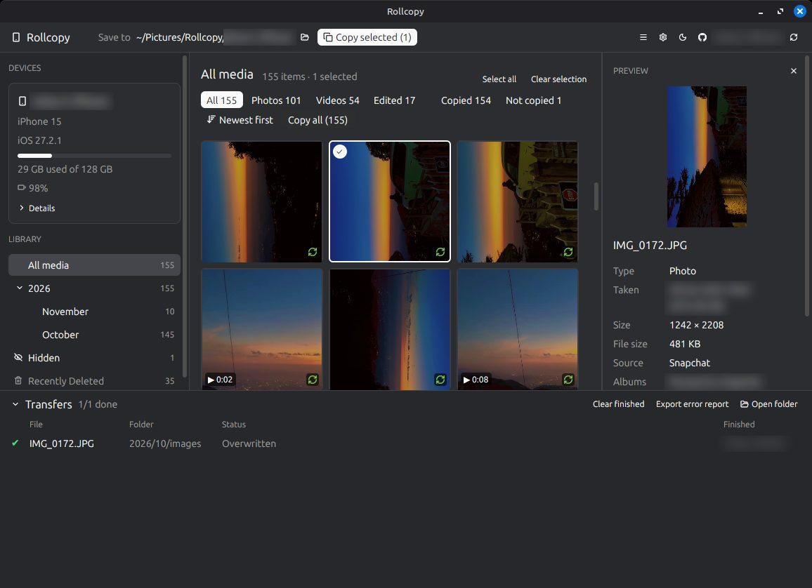

# Rollcopy: copy iPhone photos and videos to Linux

[](https://github.com/ankurk91/rollcopy-desktop-app/actions/workflows/ci.yml)
[](https://github.com/ankurk91/rollcopy-desktop-app/releases/latest)
[](LICENSE)

A **Linux desktop app** that copies photos and videos from an iPhone over a USB cable, as files any
Android phone, PC or TV can open. No iTunes, no cloud, no account.

Plug in the phone, tap **Trust**, pick what you want, and Rollcopy copies it to
`~/Pictures/Rollcopy/<phone name>/YYYY/MM/images|videos/`, converting HEIC to JPG and MOV to MP4
on the way.



> **Status:** early (0.4.0). Linux only. Tested on Linux Mint 22 (Cinnamon, X11) with iOS 27, and on
> Ubuntu 26.04 (GNOME, Wayland) in a virtual machine.

## Features

- **Browse the Photos library**: by year and month, or by **album**, with month headings in the
  grid; zoomable thumbnails; filters (photos, videos,
  edited, copied / not copied), sort by date taken, keyboard navigation, and a full-window viewer
  (Space), and **search** by name, place, album, app or camera (Ctrl+F). A **list view** with resizable columns shows names, dates and sizes without any
  thumbnails: quicker, and nothing on screen for people looking over your shoulder. Photos taken
  while the phone is plugged in appear with **Reload** (F5).
- **Private by default**: the Hidden album (locked by Face ID on the phone) and Recently Deleted
  aren't shown or copied unless you turn them on in Preferences, and then only under their own
  entries, never in "All media" or albums. Even then, Hidden items stay blurred (in the grid, the
  preview and the viewer) until you click the 👁 on each one.
- **Details for each item**: date and time zone, size, camera and lens, the app that saved it
  (Camera, WhatsApp, Snapchat, …), place name, location (open it in Google Maps), albums.
- **Android/PC-friendly copies**:
  - HEIC → JPG (keeps colour profile and EXIF, applies rotation)
  - MOV → MP4 (lossless by default; optional H.264 re-encode for old devices, using the GPU through
    VA-API and Vulkan when available)
  - Edited photos and videos are copied as edited; Live Photos as the still.
- **Safe copying**: files are written to a temporary file, checked, then renamed, so a failed copy
  never damages an existing file. Already-copied items are recognised in the folder by name and
  capture time. iPhones reuse names like `IMG_0057` after 9,999 photos; a different photo with the
  same name is saved as `IMG_0057 (2).JPG`, never over another file. For an item copied before, you
  choose Ask / Skip / Overwrite.
- **Transfer queue** with progress, time taken per item, pause/resume, cancel, retry and an
  exportable error report; the panel and its columns can be resized. Unplugging or locking the phone
  pauses the queue instead of failing items, and it carries on when the phone is back. A full disk
  pauses it too.
- **Tray icon and notifications**: closing the window during a copy keeps Rollcopy running in the tray;
  starting Rollcopy again brings the window back.
- **Preferences** for the destination, folder layout, JPEG quality, video format and theme.

### Your phone is safe

Rollcopy **only reads** from the phone. It has no code to write, rename or delete anything on the
device. The only change it makes is the trust record created when you tap **Trust**, the same as
connecting to a Mac or PC.

### Network use

None, except **Check for updates** (manual, or optionally once a day), which asks GitHub for the
latest release. Nothing is uploaded. The 📍 button next to a photo's location opens Google Maps in
your browser, only when you click it.

## Requirements

- Ubuntu 24.04 or newer, or a distribution based on it (Linux Mint 22+, Pop!_OS 24.04, …), 64-bit x86.
- `usbmuxd` (talks to the phone) and `ffmpeg` **6.1 or newer** (video conversion; Ubuntu 24.04
  ships 6.1.1). The optional H.264 re-encode also needs ffmpeg's `zscale` and `tonemap` filters,
  which Ubuntu's build includes:

  ```sh
  sudo apt install usbmuxd ffmpeg
  ```

- A USB cable that carries data.

## Install

Download the latest `.deb` or `.AppImage` from
[Releases](https://github.com/ankurk91/rollcopy-desktop-app/releases).

**.deb** (installs `usbmuxd` and `ffmpeg` if needed):

```sh
sudo apt install ./rollcopy_0.4.0-1_amd64.deb
```

**AppImage** (install `usbmuxd` and `ffmpeg` first, see Requirements):

```sh
chmod +x Rollcopy-0.4.0-x86_64.AppImage
./Rollcopy-0.4.0-x86_64.AppImage
```

**From source** for your user only (see [Building from source](#building-from-source)):

```sh
packaging/install-local.sh              # builds and installs into ~/.local
packaging/install-local.sh --uninstall
```

## Using it

1. Connect the iPhone with a cable and unlock it.
2. Tap **Trust** on the phone and enter your passcode when asked.
3. Pick items (click, Ctrl/Shift+click, Ctrl+A, arrow keys) and press **Copy selected**, or
   **Copy all** for the year, month or album you're viewing. Switch between the grid and the list
   with the buttons next to *Newest first*.
4. Change where files go with **Save to** (📁) or in **Preferences** (⚙ or Ctrl+,).
5. Took new photos while plugged in? Press **↻** next to the phone's name (or F5).

| Key | Action |
|---|---|
| ← → ↑ ↓ | Move between items |
| Shift + arrows | Extend the selection |
| Ctrl+A / Esc | Select all / clear the selection (Esc also closes the viewer) |
| Space / Enter / double-click | View the photo full-window (videos open in your player) |
| Ctrl+F | Search by name, place, album, app or camera |
| Ctrl+= / Ctrl+− / Ctrl+0 | Bigger / smaller / default thumbnails (also Ctrl+scroll) |
| In the viewer: scroll, double-click, drag | Zoom, 100%, move a zoomed photo |
| I | Details (in the viewer) |
| F5 / Ctrl+R | Reload the library from the iPhone (new photos) |
| Ctrl+, | Preferences |
| F1 | Keyboard shortcuts |
| Ctrl+Q | Quit |

## Troubleshooting

- **"The connection keeps dropping" / phone not detected:** try another cable or USB port, without
  a hub. Many cheap cables only charge.
- **"Unlock your iPhone and tap Trust" doesn't go away:** unplug, unlock the phone, plug in again and
  tap **Trust**. If you tapped **Don't Trust**, unplugging and plugging in asks again.
- **Saving to a network share:** shares opened in Files (`smb://…`, under `/run/user/…/gvfs/`), sshfs
  and some USB-drive FUSE drivers work. Rollcopy still never replaces a file that's already there.
- **Videos don't play (fresh Ubuntu):** Ubuntu's video player can't decode iPhone (HEVC) or app
  (H.264) videos until its codecs are installed: `sudo apt install gstreamer1.0-libav`, or install
  VLC. Rollcopy says so when you *Open* a video and the codecs are missing. The copied files are fine.
- **Videos play in black and white:** iPhone videos are HDR (HLG / Dolby Vision). Some Linux players,
  such as Celluloid/mpv on some setups, show these in black and white. The file is fine; VLC,
  Android and iPhone play it in colour. To get standard-colour H.264 files, choose
  *Preferences → Conversion → Videos → H.264 (slower)*.
- **Something failed:** the transfer panel shows the reason. *Export error report* saves a CSV, and
  `~/.local/state/rollcopy/rollcopy.log` has the app's log.

Please report problems with *☰ → Report an Issue*: it opens a GitHub issue form with the version,
Linux version and phone model filled in (never the phone's name or serial). Or use
[Issues](https://github.com/ankurk91/rollcopy-desktop-app/issues) directly.

## FAQ

**How do I transfer photos from an iPhone to Ubuntu or Linux Mint?**
Install Rollcopy, connect the iPhone with a USB cable, tap **Trust** on the phone, select the photos
and click **Copy selected**. No iTunes, iCloud or Apple account is needed.

**Can it convert HEIC to JPG?**
Yes, while copying. HEIC photos become JPG (quality 92 by default, colour profile and EXIF kept) and
MOV videos become MP4. JPG, PNG and MP4 files are copied unchanged.

**Does it copy Live Photos and edited photos?**
Edited photos and videos are copied as edited. Live Photos are copied as the still photo.

**Does it work on Fedora, Arch or other distributions?**
The `.deb` is for Ubuntu 24.04+ and its derivatives. The AppImage may run on other 64-bit distributions
with glibc 2.39 or newer, with `usbmuxd` and `ffmpeg` installed; this isn't tested yet.

**Can it delete photos from the iPhone or free up space?**
No. Rollcopy only reads from the phone; it never changes or deletes anything on it.

## Where Rollcopy keeps things

| Path | What |
|---|---|
| `~/.config/rollcopy/config.toml` | Preferences |
| `~/.local/state/rollcopy/` | Window layout, failed-copy history, `rollcopy.log` (attach it to bug reports) |
| `~/.cache/rollcopy/` | Thumbnails (safe to delete) |

The cache and state folders are readable by you only. While a phone loads, Rollcopy copies its Photos
database (dates, places, albums) into `~/.cache/rollcopy/db/` and deletes it as soon as the library is read.
Full-size photos for the viewer and files you *Open* are kept in `~/.cache/rollcopy/view/` and `open/` until
Rollcopy quits. Thumbnails stay until you reset; those of Hidden-album items are deleted unless you show that album.

*Preferences → App → Reset and restart* clears all three (never your copied files or the phone).

## Building from source

Ubuntu 24.04 packages (the same list CI uses):

```sh
packaging/ci-deps.sh      # build-essential cmake clang libxkbcommon-dev libde265-dev …
```

Then, with Rust stable from [rustup](https://rustup.rs):

```sh
cargo run -p rollcopy-app                      # run the app
cargo test --workspace                        # tests
cargo clippy --workspace --all-targets        # lints
cargo deb -p rollcopy-app                      # .deb (needs cargo-deb 3.8)
packaging/build-appimage.sh                   # AppImage
```

The workspace is split into headless crates (device access, Photos library, conversion, copy queue)
and the gpui app. [docs/PLAN.md](docs/PLAN.md) has the design, decisions and what was learned about iOS along
the way. AI coding agents: see [AGENTS.md](AGENTS.md).

## Licence

[MIT](LICENSE). Built with [gpui](https://github.com/zed-industries/zed) and
[gpui-kit / gpui-component](https://github.com/longbridge/gpui-kit) (Apache-2.0),
[idevice](https://crates.io/crates/idevice) (MIT), libheif and libde265 (LGPL-3.0), FFmpeg
(run as a separate program) and [Lucide](https://lucide.dev) icons (ISC).

libheif and libde265 are under the LGPL-3.0. libde265 is linked dynamically (the system's copy).
libheif is compiled into the `rollcopy` binary through the
[libheif-rs](https://crates.io/crates/libheif-rs) crate's `embedded-libheif` feature. As the LGPL asks,
you can rebuild Rollcopy with a modified libheif: the complete source is in this repository and
[Building from source](#building-from-source) shows how; point the `libheif-sys` crate at your libheif
with a `[patch.crates-io]` entry, or turn `embedded-libheif` off to link a system libheif.
